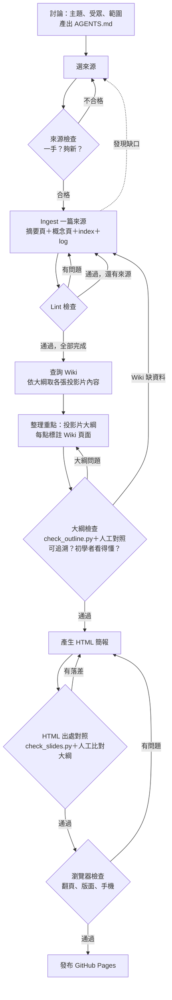

# Loop／Graph 設計

主題：釣魚郵件怎麼辨識？｜使用的 LLM：Claude｜Wiki 規則見 `AGENTS.md`｜完整執行紀錄見 `wiki/log.md`

## 流程圖

## 流程說明

| 節點 | 做什麼 | 產出 | 檢查方式 |
|---|---|---|---|
| 討論 | 和 LLM 討論主題、受眾、深度、來源偏好 | `AGENTS.md`、log 第一筆 | 人確認 |
| 選來源 | LLM 搜尋候選來源，每篇對應簡報一個區塊 | `raw/sources.md` | 一手？夠新？符合偏好？ |
| Ingest | 一次處理一篇：摘要頁＋更新概念頁＋index＋log | `wiki/sources/`、`wiki/concepts/` | 下一步 Lint |
| Lint | 自動檢查＋逐句對照原文 | log 紀錄 | `tools/lint.py`＋人工 |
| 查詢 Wiki | 依簡報結構從概念頁取內容 | — | 只能用 Wiki 內容 |
| 整理重點 | 排出投影片大綱，每個事實句標註頁面與來源 | `slides/outline.md` | 下一步大綱檢查 |
| 大綱檢查 | 可追溯性＋初學者能否看懂 | log 紀錄 | `tools/check_outline.py`＋人工 |
| 產生 HTML | 依大綱生成簡報，每張附出處連結 | `slides/index.html` | 下一步 HTML 檢查 |
| HTML 出處對照 | 出處標記是否對得上 Wiki、內容是否和大綱一致 | log 紀錄 | `tools/check_slides.py`＋人工 |
| 瀏覽器檢查 | 翻頁、版面、手機、錯誤 | 截圖 | Playwright（桌機＋手機尺寸） |

## 會重複執行的步驟

1. **Ingest → Lint**：每篇來源跑一次，共 7 篇（S01–S07），每篇至少 lint 一次，有問題就修正後重跑。
2. **Lint 失敗 → 回到 Ingest 修改**：S01、S02、S03、S04＋S07、S05 都經過「修正後重跑」。
3. **Ingest 發現缺口 → 回到選來源**：S04 只教打開標頭、沒教看驗證結果，回頭補了 S07。
4. **大綱檢查失敗 → 回到整理重點**：大綱 v1 有 5 處問題，修正後重跑；對照作業要求後又改成 v2 再檢查一次。
5. **HTML 檢查失敗 → 重新生成**：HTML 第 1 次有 1 處內容落差、1 處版面問題，修正後重跑。

## 哪些地方需要檢查或重新生成

| 檢查點 | 為什麼要在這裡檢查 | 自動檢查 | 人工檢查 |
|---|---|---|---|
| 來源檢查（ingest 前） | 來源錯了，後面全部白做 | — | 是否一手、是否符合偏好 |
| Lint（每篇 ingest 後） | 改寫成 Wiki 句子時最容易加料 | 未標來源、來源不存在、壞連結、孤兒頁 | 逐句對照原文 |
| 大綱檢查（生成 HTML 前） | 在最便宜的階段確認每一點都有出處 | 頁面存在、頁面引用該來源、句子相似度 | 句子是否真的在那一頁、`[教學]` 有沒有夾帶主張 |
| HTML 出處對照（生成後） | 生成時 LLM 可能再加字 | 出處標記對得上 Wiki | HTML 與大綱逐句比對 |
| 瀏覽器檢查 | 「可以實際瀏覽」是作業要求 | JS 錯誤、水平捲動 | 截圖看版面 |

## 為什麼這樣設計

- **一次 ingest 一篇，每篇都 lint**：錯誤在當篇就被抓到，不會累積到 7 篇以後才發現；也能統計每篇出了什麼錯。
- **每個事實都要標來源 `[S0X]`**：讓「Wiki → 簡報」的每一句都能追溯回原文，這是檢查能運作的前提。
- **自動檢查＋人工檢查並用**：自動檢查便宜、可重複，但只看得到「格式」；內容是否忠於原文只能人工對照（執行結果證實了這點，見下方統計）。
- **檢查越早越好**：來源在 ingest 前檢查、大綱在生成 HTML 前檢查，因為越後面發現問題，要回頭改的東西越多。
- **規則寫進 `AGENTS.md`**：每次發現新的錯誤類型，就把對應的規則加進去，讓下一輪生成時就受到限制，而不是只靠事後檢查。

# 實際執行紀錄（摘要）

完整紀錄見 `wiki/log.md`，以下依階段整理。

| 階段 | 執行次數 | 自動檢查抓到 | 人工檢查抓到 | 修正內容 |
|---|---|---|---|---|
| 來源選擇 | 初選＋複查 | — | 2 篇非一手來源 | 換成 Fortinet 原始研究、Verizon 官方資料 |
| Ingest＋Lint（S01–S07） | 7 篇，lint 共 12 次 | 1（連到未建立的頁面） | 10 | 刪除推論、改回原文強度、`[定義]` 去除主張 |
| 來源缺口 | 1 次 | — | 1（S04 缺驗證結果說明） | 補入 S07 |
| 大綱（v1、v2） | 檢查 4 次 | 0（加強後可抓到其中 2） | 5 | 修正出處、刪除偽裝成 `[教學]` 的主張 |
| HTML | 檢查 2 次 | 0 | 1 內容＋1 版面 | 刪除「主管」、標題斷行 |

**內容錯誤總計 16 處（ingest 10、大綱 5、HTML 1），自動檢查第一次執行時一處都沒抓到。**

錯誤類型統計：

| 類型 | 次數 | 例子 |
|---|---|---|
| 來源沒說，LLM 自己補的定義或推論 | 4 | 「所以第一封信沒有連結不代表安全」 |
| 換標籤溜回來的無來源主張 | 2 | Wiki 刪掉的推論，在大綱以 `[教學]` 重新出現 |
| `[定義]` 夾帶主張或出處標錯 | 4 | 顯示名稱的定義夾帶「可以隨便填」；Q4 標錯頁面 |
| 說得比原文強／脫離原文脈絡 | 2 | Google 談「送達率」的句子被改寫成「通過驗證不等於安全」 |
| 加油添醋的用字 | 4 | 「降低戒心」「在背景下載」「打電話查證」「主管」 |

# 反思

## 一、哪一個節點最常出錯？

最容易出錯的地方主要集中在讓 LLM 消化來源資料並改寫成目標內容的階段，具體來說就是撰寫概念頁、擬定大綱、生成 HTML 這三步。

在整個流程中我一共抓出 16 處內容錯誤，全發生在這三個地方，而且這些錯誤乍看之下都很合理。像是 Google 原文在探討寄件者送達率時，僅提到垃圾郵件發送者同樣能通過驗證，LLM 卻自行推論並改寫成「通過驗證不等於安全」。這句話在資安邏輯上雖然正確，但問題在於來源根本沒有這樣說。其他情況包括模型自行腦補術語定義、將「可能影響回報數量」誇大成「實際數量比回報更多」，甚至是憑空補上原文未提及的內容。

我以為自動檢查就能攔截大部分問題，但實際執行自動 lint check 時，這 16 處錯誤一處都沒被抓到。原因在於現有的 lint 只能驗證語法上有沒有標註來源標籤，但它不會判斷來源到底有沒有寫這句話。

## 二、發現問題後，把檢查往前移到了哪一個步驟？

我把檢查往前移了三次：

1. **提前到 Ingest 之前來確保來源品質**：在挑選資料階段，一旦發現有兩篇屬於新聞二次轉述或第三方摘要，就直接在 ingest 前退回並換成一手官方來源，避免整篇內容都產出後才發現基礎論點不可靠。
2. **移到寫作當下以提示詞限縮生成自由度**：針對 lint 發現 LLM 常擅自定義術語並偷塞引用編號的問題，我直接在 `AGENTS.md` 加入 `[定義]` 標記規範，嚴格限制模型只能用一句話解釋術語，把事後挑錯轉化為生成當下的硬性規定。
3. **卡在生成 HTML 之前以大綱作為驗收關卡**：原本流程預計等 HTML 整體排版完成後才進行審核，後來調整為要求大綱裡的每個事實句都必須明確對應到 Wiki 頁面，並透過 `check_outline.py` 與人工對照驗證其可追溯性，全部過關才放行生成 HTML。這道防線攔下了 5 個問題，如果等到 HTML 完成才發現，修改成本會高很多。

## 三、有沒有因此修改 workflow／graph？為什麼？

有，流程圖後來新增了來源檢查和 HTML 出處對照，也加上了 ingest 發現缺口時回到選來源的路徑，因為之前發生過 S04 只教怎麼打開郵件標頭，沒說明驗證結果怎麼看，所以我後來加上了 S07。

檢查工具也改了好幾次：`lint.py` 加上 `[定義]` 的人工確認清單；`check_outline.py` 加上句子相似度比對，因為原本只檢查那一頁有沒有引用這個來源，無法確認句子真的在那一頁。

修改的主要原因是，我發現每修補一個漏洞，就會出現新的漏洞。像是在 Wiki 階段刪掉的兩句無來源推論，到了大綱階段被標成 `[教學]`，換個標籤又跑了回來。所以我最後的設計是在每個 LLM 改寫內容的節點後面都放一道對照檢查，並且把每次學到的錯誤類型寫回 `AGENTS.md`，讓下一輪生成時就受到限制。

這次也讓我體會到，自動檢查適合處理格式，內容是否忠於原文目前還是需要人工逐句對照。如果再做一次，我會考慮讓第二個 LLM 專門負責逐句比對原文，或要求每個事實句附上原文頁碼，讓人工對照更快。
